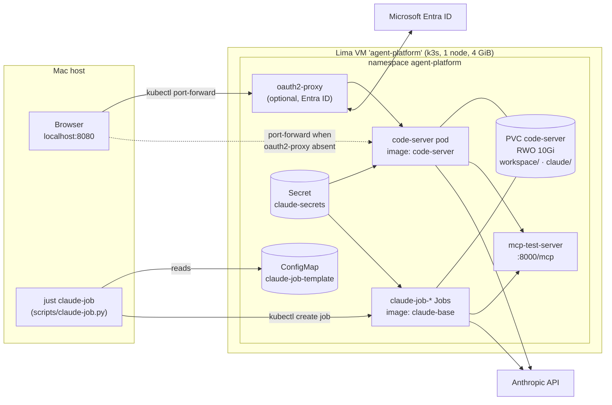

# Architecture

How agent-platform fits together and why. For setup and day-to-day commands,
see [README.md](README.md).

## Purpose

Run Claude Code for an organization in one place, with two ways in:

- **Interactive.** People use the real Claude Code VS Code extension in a
  browser, through code-server.
- **Automated.** Callers start single Claude Code turns as Kubernetes Jobs.

Both work in the **same workspace and the same session store**. A session that a
Job starts can be opened and continued in the browser, and the reverse also works.
Org-wide agents, skills, MCP servers, and instructions are built into the image,
so both ways in get identical configuration.

## System diagram

## Components

| Component | Defined in | Role |
|---|---|---|
| Lima VM + k3s | [lima/k3s.yaml](lima/k3s.yaml) | Single-node cluster. Bundled Traefik is disabled (there is no ingress); ServiceLB and local-path storage are kept. |
| `claude-base` image | [apps/claude-base/](apps/claude-base/) | Debian with the Claude Code CLI, git, and python3, plus all org configuration. User `coder` (uid 1000). Jobs run this image. |
| `code-server` image | [apps/code-server/](apps/code-server/) | `FROM claude-base:<tag>`. Adds code-server and the Claude Code extension, removes Copilot Chat, and disables VS Code's built-in AI UI. |
| code-server release | [values/code-server.yaml.gotmpl](values/code-server.yaml.gotmpl) | One Deployment running `--auth none`, plus a ClusterIP Service on 8080. Owns the workspace PVC. |
| oauth2-proxy release | [values/oauth2-proxy.yaml.gotmpl](values/oauth2-proxy.yaml.gotmpl) | Optional Entra ID sign-in in front of code-server. Deployed only when its Secret exists. |
| claude-job release | [values/claude-job.yaml.gotmpl](values/claude-job.yaml.gotmpl) | Installs only the `claude-job-template` ConfigMap, which holds a full Job spec as JSON. It runs no workload of its own. |
| Dispatcher | [scripts/claude-job.py](scripts/claude-job.py) | Fills in the template's name, prompt, session, and caller labels, then creates the Job. |
| mcp-test-server | [apps/mcp-test-server/](apps/mcp-test-server/) | Harmless HTTP MCP fixture (`echo` tool and prompt) that proves cluster MCP wiring works. |

Helmfile ([helmfile.yaml](helmfile.yaml)) orders the releases. All of them go
in `agent-platform` and use the bjw-s `app-template` chart. There is no ingress
controller: the only way in is `kubectl port-forward`.

## Key flows

### Interactive session

1. `just code-server` loops `kubectl port-forward` to `localhost:8080`. It
   targets oauth2-proxy if that Service exists, and code-server otherwise.
2. oauth2-proxy signs the user in with Entra ID and proxies to code-server.
3. The Claude Code extension runs in code-server and authenticates with
   `CLAUDE_CODE_OAUTH_TOKEN` from `claude-secrets`. It writes sessions to
   `~/.claude/projects/-home-coder-workspace/<id>.jsonl` on the PVC.

The forwarded port must be `localhost`. Browsers treat it as a secure context,
which service workers and the extension's webview need, and it matches the
Entra redirect URI.

### Automated turn (Job)

1. `claude-job.py` reads `claude-job-template` from the cluster.
2. It sets the Job's name and the `PROMPT`, `SESSION_ID`, and
   `claude-session`/`claude-started-by` labels:
   - The name is `claude-` + sha256 of `--turn-id`, or of a random UUID.
   - The session is a new UUID unless `--session` is given.
3. `kubectl create` runs. If the Job already exists, the error is treated as
   success. This makes a `--turn-id` dispatch idempotent.
4. The pod mounts the same PVC subpaths as code-server. It runs
   `claude -p ... --permission-mode bypassPermissions` and passes `--resume` if
   the session file exists, or `--session-id` if it doesn't.
5. `CLAUDE_CODE_ENTRYPOINT=claude-vscode` makes the extension's Session Manager
   list the session.
6. The result is the last line of the pod log (JSON). `--wait` polls the Job
   and prints it.

Any client that can create a Job from the template can dispatch turns, for
example a CronJob, CI, or a workflow engine. The Python script is only a
convenience.

### Image build and release

`just build-image <component>` streams the sources to `docker build` in the
VM, then imports the image into k3s containerd with `k3s ctr images import`. No
registry is involved. Tags live only in [image-tags.yaml](image-tags.yaml); the
build and the Helm values both read them, so a release means: bump the tag,
build, and `helmfile sync`. Org config changes need rebuilds of
both images, because `code-server` is built on top of `claude-base`.

## Configuration layering

Org config lives **outside `~/.claude`**. Users keep their own settings and
history, and an image rebuild can't overwrite them.

| Layer | Location in image | Source |
|---|---|---|
| Managed settings (registers and enables the `org` plugin) | `/etc/claude-code/managed-settings.json` | [apps/claude-base/managed-settings.json](apps/claude-base/managed-settings.json) |
| Managed instructions | `/etc/claude-code/CLAUDE.md` | [apps/claude-base/CLAUDE.md](apps/claude-base/CLAUDE.md) |
| `org` marketplace + plugin | `/opt/claude-org/` | [apps/claude-base/org/](apps/claude-base/org/) |
| Agents | `/opt/claude-org/plugins/org/agents/` | [agents/](agents/) |
| Skills | `/opt/claude-org/plugins/org/skills/` | [skills/](skills/) |
| MCP servers | `/opt/claude-org/plugins/org/.mcp.json` | [apps/claude-base/org/plugins/org/.mcp.json](apps/claude-base/org/plugins/org/.mcp.json) |
| User settings and sessions | `~/.claude` (PVC) | Written at runtime |
| Editor settings | `~/.local/share/code-server` (image) | Set in the code-server Dockerfile; changes reset on restart |

## State

All durable state is one ReadWriteOnce PVC (`code-server`, local-path, 10Gi)
with two subpaths:

- `workspace/` → `/home/coder/workspace`: the files Claude works on.
- `claude/` → `/home/coder/.claude`: sessions, user settings, and CLI state.

The rest of `/home/coder` stays in the image, so the CLI and extension
installed there aren't hidden by the mount. Both pods use uid/gid 1000, and the
home path is the same, so the encoded session folder
(`-home-coder-workspace`) matches between the IDE and Jobs. The Job command
hard-codes that folder.

Secrets (`claude-secrets` and `oauth2-proxy`) are created by `just secrets`
from `.env`, outside Helm. `helmfile destroy` leaves them and the PVC in place.

## Trust and security model

This is a **single-tenant lab**, not a multi-user platform.

- **One identity.** Everyone who signs in shares one code-server, one
  workspace, and one Claude OAuth token. Entra ID controls who gets in, not
  what they can see. Inside, all users are the same user.
- **Jobs run unattended with full permissions.** `bypassPermissions` lets a Job
  run any tool, including shell, against the shared workspace and `~/.claude`.
  Treat whoever can create Jobs (or edit the template ConfigMap) as having full
  workspace access.
- **No network policy.** Any pod, including Claude running a shell command, can
  reach any in-cluster service and the internet.
- **Kubernetes API access.** Jobs, oauth2-proxy, and mcp-test-server disable
  service-account token mounting. code-server doesn't, so it gets the namespace's
  `default` service account token. That account has no RBAC bindings, but
  setting `automountServiceAccountToken: false` there too would be consistent.
- **Prompts are visible.** `PROMPT` is a plain env var in the Job spec. Anyone
  who can read Jobs in the namespace can read prompts.
- **Plain HTTP throughout.** It is only reachable through `localhost`
  port-forwarding, and oauth2-proxy cookies are not `Secure`.

## Constraints and scaling limits

| Constraint | Why | What changes it |
|---|---|---|
| One node | The PVC is RWO, so Jobs only start where code-server's volume is attached | RWX storage, or node affinity to code-server's node |
| No per-session lock | Nothing stops two Jobs (or a Job and a person) from writing to the same session file | A dispatcher-side lock or queue per session |
| One workspace | Single code-server Deployment and PVC | Per-user workspaces (e.g. Coder) and per-user tokens |
| Version skew | The extension bundles its own Claude Code; Jobs use the CLI in `claude-base` | Accept it (session format is shared), or pin both |
| 4 GiB VM | Sized for a 16 GiB Mac; Job limit 1 GiB, code-server limit 2 GiB | Fewer concurrent Jobs, or a larger VM in `lima/k3s.yaml` |
| Job limits | 1 h deadline, no retries, deleted 24 h after finishing | `values/claude-job.yaml.gotmpl` |

## Open questions

- **mcp-test-server installs `mcp` from PyPI on every start.** The pod needs
  internet access at boot, and restarts are slow. A small image would remove
  both problems.
